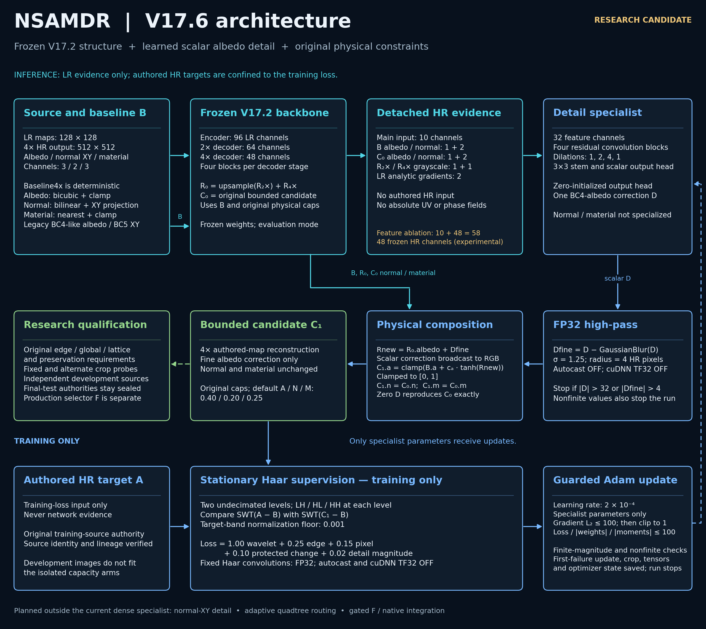
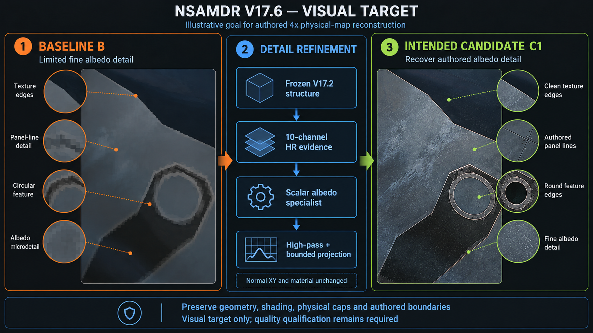

# NSAMDR — Neural Structure-Aware Material Detail Reconstruction

## Architecture: V17.6

NSAMDR reconstructs **4× higher-resolution authored physical textures** from aligned lower-resolution texture maps. It separates deterministic reconstruction, learned broad-scale structure, and specialized fine-scale detail. The output is a constrained reconstruction candidate, not unrestricted texture generation.

The **V17.6 architecture** consists of the existing V17.2 structural network plus an additional high-frequency detail specialist. Adaptive quadtree routing and normal-detail specialization are separate planned extensions.

### System architecture

[](./NSAMDR_FULL_SYSTEM_ARCHITECTURE.png)

The diagram separates the LR-only inference path from authored-HR training supervision. It includes the experimental 58-channel feature input and shows planned extensions outside the current dense specialist.

### Visual target

[](./EXAMPLE.png)

This conceptual illustration defines the intended recovery of authored albedo edges and fine detail while preserving geometry, shading, physical caps and authored boundaries. It is a visual target; measured proof reports and the original quality gates establish model performance. Normal XY and material remain the original V17.2 outputs.

### Overall data flow

```text
128 × 128 aligned LR physical maps
   ├─ albedo RGB representation (3 channels)
   ├─ normal XY                 (2 channels)
   └─ material                 (3 channels)
       │
       ├───────────────────────────────────────────────────┐
       │                                                   │
       ▼                                                   ▼
Deterministic Baseline4x B                       V17.2 physical encoder
bicubic albedo, normalized normals,             96 channels at LR
nearest-neighbour material                        │
       │                                          ▼
       │                                 2× structural residual decoder
       │                                  64 channels, four blocks
       │                                          │
       │                                          ▼
       │                                 4× detail residual decoder
       │                                  48 channels, four blocks
       │                                          │
       │                                          ▼
       │                              Bounded V17.2 candidate C₀
       │                                          │
       └────────────────────┬─────────────────────┘
                            │
                            ▼
              10-channel HR evidence assembly
                            │
                            ▼
                 V17.6 fine-detail specialist
                 32 channels, four residual blocks
                 dilation = (1, 2, 4, 1)
                            │
                            ▼
                  Scalar high-frequency residual
                  Gaussian high-pass (σ = 1.25)
                            │
                            ▼
               Add to V17.2 raw albedo residual
               original tanh cap and projection
                            │
                            ▼
                   Refined 4× candidate C₁
                            │
                            ▼
          Existing qualification / future selector F
```

All spatial sizes above are illustrative of the standard **128 LR → 512 HR** crop. The architecture is strictly 4×. No absolute UV positions, repeating subpixel-phase coordinates, PixelShuffle, transposed convolutions, or inference-time authored-HR supervision are used.

## Physical map interface and baseline

| Map | Input channels | Deterministic B reconstruction | V17.6 Stage 10A |
|---|---:|---|---|
| Albedo | 3 | Bicubic and clamp to [0, 1] | One grayscale fine correction broadcast across three albedo channels |
| Normal XY | 2 | Bilinear interpolation and XY length projection | Unchanged from V17.2 |
| Material | 3 | Nearest-neighbour interpolation and clamp | Unchanged from V17.2 |

The current legacy authored corpus supplies **BC4-like scalar albedo** and **BC5 normal XY** for the verified sources. The RGB albedo representation therefore does not imply three independent physical albedo measurements. Material inputs can contain neutral unsupervised placeholders; V17.6 does not infer material semantics where supervision is absent.

The deterministic baseline **B is never learned or modified**. The network produces a bounded candidate **C**, preserving the original distinction between a baseline, a candidate, and the separately gated final output **F**.

## V17.2 structural backbone — preserved

**Implementation:** `tools/nsamdr/neural/v17/model.py`

The encoder consumes eight aligned physical-map channels and produces 96 LR feature channels. A learned 2× residual stage uses 64 channels, followed by a 4× stage with 48 channels. Each decoder stage has four resize-convolution residual blocks. The decoder predicts eight raw physical correction channels: three albedo, two normal XY, three material.

```text
R₀ = upsample(R₂ₓ) + R₄ₓ

C₀.albedo   = clamp(B.albedo + cₐ · tanh(R₀.albedo), 0, 1)
C₀.normalXY = normalize_xy(B.normalXY + cₙ · tanh(R₀.normalXY))
C₀.material = clamp(B.material + cₘ · tanh(R₀.material), 0, 1)
```

The residual caps are inherited unchanged from the current physical configuration: `cₐ = 0.40`, `cₙ = 0.20`, `cₘ = 0.25` by default.

For V17.6 detail specialization, the V17.2 backbone runs in evaluation mode with its parameters frozen. Its selected learned structure, projected candidate maps, and 2×/4× residual maps provide inference evidence to the specialist.

## V17.6 high-frequency specialist — Stage 10A

**Implementation:** `tools/nsamdr/neural/v176/fine_detail.py`

The specialist does **not** recreate the full decoder or predict a new broad-scale image. It learns a **single scalar high-frequency albedo correction** from the current V17.2 result and source evidence.

Its ten HR input channels are:

| Evidence | Channels |
|---|---:|
| Deterministic B albedo, averaged across RGB | 1 |
| Deterministic B normal XY | 2 |
| V17.2 C₀ albedo, averaged across RGB | 1 |
| V17.2 C₀ normal XY | 2 |
| V17.2 2× residual upsampled to HR, grayscale | 1 |
| V17.2 4× detail residual, grayscale | 1 |
| Analytic LR edge evidence upsampled to HR | 2 |
| **Total** | **10** |

Architecture: a 3×3 convolutional stem, **32-channel** feature width, four residual convolution blocks with dilations **1, 2, 4, 1**, and a single-channel 3×3 output head. The final output convolution is **zero-initialized**, so the specialist initially makes no change to the V17.2 candidate.

No authored target is passed to this network during inference. All backbone tensors are detached from the specialist's gradient graph.

The controlled **HR-feature ablation** adds 48 frozen 4× decoder feature channels to the ten-channel evidence, giving a 58-channel specialist input. It retains the same scalar output, residual-block layout and physical composition. The additional stem-channel weights are initially zero.

### Phase-neutral physical composition

**Implementation:** `tools/nsamdr/neural/v176/physical_composition.py`

The specialist output is spatially high-pass filtered, with Gaussian `σ = 1.25` HR pixels and filter radius `4`. Filtering operates at full HR resolution without downsampling or repeating 4× subpixel-phase fields.

The fixed Gaussian and Haar convolutions use FP32 with autocast and cuDNN TF32 disabled. Finite-magnitude and nonfinite guards stop an unstable research run and preserve first-failure tensor evidence. The physical projection continues to use the original residual caps.

```text
D       = Specialist(LR maps, B, C₀, V17.2 residual bands)
D_fine  = D − GaussianBlur(D, σ = 1.25)
R_new   = R₀.albedo + broadcast_rgb(D_fine)
C₁.a    = clamp(B.a + cₐ · tanh(R_new), 0, 1)
C₁.n    = C₀.n
C₁.m    = C₀.m
```

The high-pass correction is added **before** the original residual cap, not after the final albedo projection. This preserves the same physical range. Normal XY and material maps are passed through unchanged. With a zero specialist output, **C₁ equals C₀ exactly**.

Phase-neutral operations avoid introducing a fixed phase lattice by design; they do not guarantee that all learned periodic artefacts disappear. Original phase/lattice qualification still applies.

## Fine-frequency supervision

**Implementation:** `tools/nsamdr/neural/v176/wavelet_supervision.py`

Training uses a **two-level undecimated (stationary) Haar transform** on the target-vs-baseline and candidate-vs-baseline albedo differences. At each level, the loss compares the three directional bands: `LH`, `HL`, and `HH`. Both levels retain the original HR spatial dimensions. The transform is a *training objective*, not an inference-time reconstruction or resampling stage.

```text
Reference bands = SWT(A − B)
Candidate bands = SWT(C₁ − B)

L_detail =
    1.00 × mean(normalized directional-band L1)
  + 0.25 × signed edge-gradient error
  + 0.15 × albedo pixel L1
  + 0.10 × protected-region correction
  + 0.02 × high-frequency correction magnitude
```

Directional-band normalization uses target-band magnitude with a positive denominator floor. Only the specialist parameters receive optimizer updates; original backbone outputs, weights, and physical-map semantics are fixed. Ground-truth authored HR textures are available to the training loss only, never as model inputs or adaptive-routing evidence.

## Adaptive quadtree refinement — planned

The later quadtree controller operates in **2D texture space**, using input evidence to allocate detail-specialist computation without generating additional features itself.

Proposed hierarchy:

| Leaf size in LR pixels | Corresponding 4× HR region | Refinement |
|---|---|---|
| 32 × 32 | 128 × 128 | Coarse region |
| 16 × 16 | 64 × 64 | Intermediate region |
| 8 × 8 | 32 × 32 | Fine region |

Potential routing features are albedo/normal gradients, regional structural complexity and predicted uncertainty available at inference. Refinement boundaries require overlap/halo blending and protection of known UV-island discontinuities. Full-density routing must reproduce dense inference within a defined tolerance.

**Quadtree routing is not part of Stage 10A.** It is an optional extension after the dense specialist independently demonstrates improved authored-detail reconstruction.

## Planned subsequent architecture extensions

- **Stage 10B:** Separate bounded normal-XY fine-detail output, retaining normalization and physical consistency. Material semantics remain unchanged until real material supervision exists.
- **Stage 11:** Dense-versus-adaptive quadtree routing using the same trained specialist, followed by learned routing only if necessary.
- **Later gated integration:** The existing BenefitSelector **F**, UV/material constraints, and native renderer remain separate qualification steps; improvement in a research candidate does not automatically promote production output.

## Source-code boundaries

| Module | Architectural responsibility |
|---|---|
| `neural/v17/model.py` | Existing eight-channel structural encoder, 2×/4× decoder and physical projection |
| `neural/v14/baseline.py` | Deterministic baseline B and normal projection |
| `neural/v176/fine_detail.py` | Frozen-backbone wrapper and high-frequency residual specialist |
| `neural/v176/detail_capacity.py` | Experimental 58-channel frozen-HR-feature input and detail diagnostics |
| `neural/v176/physical_composition.py` | Gaussian high-pass, bounded scalar-albedo composition |
| `neural/v176/wavelet_supervision.py` | Two-level undecimated directional-band training supervision |
| `neural/v176/stability.py` | Finite-magnitude guards, specialist-only optimizer updates and failure evidence |
| `neural/v14/qualification.py` | Existing recovery, preservation and 4× phase/lattice metrics |

The original V17.2 implementation and previous trained evidence remain separate from V17.6. The sealed final-test authorities are not training inputs.
