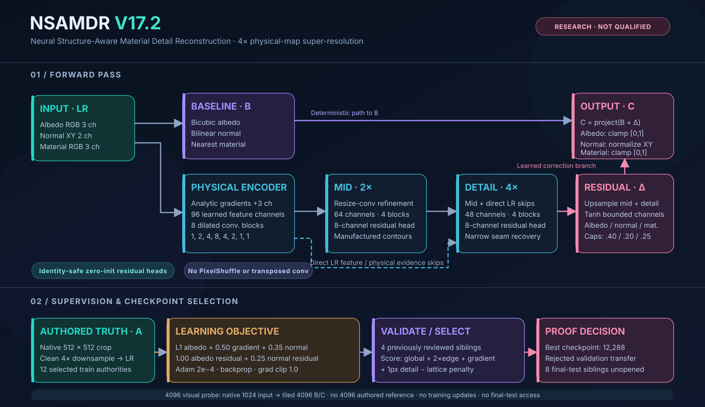

# NSAMDR

**Neural Structure-Aware Material Detail Reconstruction** reconstructs aligned EVE ship material textures at **4x** while preserving authored structure and avoiding unsupported invention.

[](./EXAMPLE.png)

## Current architecture status — V16 rejected; V17.4 transfer unqualified; V17.5 diversity proof implemented

The README visual target is now an **architecture gate**, not a late production
check. A candidate that improves aggregate metrics but still looks like a
pixelated/sharpened deterministic baseline is rejected.

V16 is retained for reproducibility and as negative evidence, but it is no
longer the active reconstruction architecture.

### Why V16 was rejected

V16 proved train-fit capacity but failed the actual spatial-generalisation
requirement:

```text
fixed known crops
    1 authority                    >60% recovery; candidate gates pass
    4 authorities                 >60% recovery; candidate gates pass
    16 authorities                ~60% global / ~65% edge

same-authority unseen sibling crop
    global / edge                  ~14-17% range

broad spatial Main, step 1192
    global                         14.16%
    edge                           11.04%
    gradient                       10.66%
    lattice excess                 21.55%

V16 wider-LR-context probe
    global                         15.63%
    edge                           13.09%
    gradient                       12.30%
    lattice excess                 21.32%
```

The fixed-crop results established that V16 can **memorise and represent** the
required authored residual. They did not establish that its reconstruction
representation can infer where missing sub-LR-pixel structure belongs on unseen
material.

The failure mechanism is now explicit. V16 first creates an HR grid through
bicubic/bilinear interpolation, then asks a fixed-HR Swin refinement body to
correct that already-upsampled baseline. It has no learned reconstruction
decoder and no explicit relative subpixel query. This is a poor match for the
source material: long manufactured seams, narrow panel features and aligned
physical-map boundaries whose HR placement can lie inside a single LR texel.

Do **not** spend more GPU time extending V16 Main epochs, the V16 pyramid-context
probe, residual-gain tuning or broad-authority scaling. Those questions are
closed.

### V17 architecture proof — V17.0/V17.1 rejected, V17.2 under evaluation

V17.0 correctly moved reconstruction into LR feature space, but its decoder used
a repeating coordinate phase inside every LR texel. That recreated explicit 4x
phase ownership and produced a severe lattice.

V17.1 removed that phase ownership with a four-anchor local-ensemble implicit
decoder. It was more stable and its train-fit curve improved, but by 1536 exact
single-crop updates it was flattening far below the known fixed-crop capability:

```text
V17.1 trained crop @1536
    global recovery          28.48%
    edge recovery            24.84%
    gradient recovery        20.50%
    1px detail                7.24%
    lattice excess           20.37%

candidate gates
    global                   >=45%
    edge                     >=60%
    gradient                 >=35%
    lattice                  <=15%
```

The V17.1 candidate residual had learned the broad correction direction, but the
bilinear local-ensemble decoder still favoured smooth/broad structure over
narrow authored 1-2 px manufactured detail. The sibling crop was correctly not
evaluated because train fit never passed.

### V17.2 experimental architecture



*Dark-theme vector diagram; [open the full-resolution SVG](./assets/v17_2_learning_architecture.svg). The inference graph is distinct from the training and validation paths.*


V17.2 keeps the LR physical encoder and replaces the smooth implicit decoder
with an explicit learned residual pyramid:

```text
LR albedo RGB + normal XY + material RGB
                    |
                    v
       physical LR feature encoder
       + analytic physical-map gradients
       + wide LR receptive field
                    |
                    v
             256 residual stage
       resize-convolution + residual blocks
       predicts mid-band physical residual
                    |
                    v
             512 detail stage
       refined 256 features
       + direct LR latent/evidence path
       + resize-convolution residual blocks
       predicts narrow high-detail residual
                    |
                    v
        upsample(mid residual) + detail
                    |
                    v
       bounded physical residual (A/N/M)
                    |
                    v
             project(B + residual)
                    |
                    v
                    C
```

This decoder gives the model an actual learned 512-resolution detail-generation
stage instead of asking a smooth anchor blend to express 1px seams. It still
uses no absolute UV input, no periodic phase/Fourier encoding, no PixelShuffle,
no transposed convolution and no fixed-HR Swin reconstruction body.

The deterministic baseline B, aligned physical-map contract, normal projection,
qualification metrics, lattice checks and later BenefitSelector contract remain
unchanged.

#### Generalization V2 evidence — 12 October 2026

**Status: research-only; validation transfer rejected, not qualified for native
integration or production.** The current V17.2 architecture is still the
experimental candidate; the Generalization V2 proof does not establish
successful transfer.

V2 uses 12 eligible `_000` training crops from distinct authored authorities,
four *already examined* V1 `_001` sibling crops for repeatable development
validation, and eight additional `_001` sibling crops held for one sealed
final-test evaluation. The final test was **not** opened, because the training
and validation gates did not qualify together. The 12 training authorities
include the four development authorities; the eight sealed test crops are
siblings of the other eight training authorities, **not** independent
unseen-authority tests.

| Bounded checkpoint | Mean trained edge recovery | Mean validation edge recovery | Validation objective |
| --- | ---: | ---: | ---: |
| 6,144 | 21.42% | 20.18% | 0.9214 |
| **12,288 (selected)** | **32.29%** | **24.15%** | **1.0568** |
| 18,432 | 38.05% | 22.64% | 1.0034 |
| 24,576 (stopped) | 41.92% | 24.01% | 1.0289 |

- The model selected the **12,288-update** checkpoint using the four reviewed
  validation siblings; further training fit did not consistently improve
  validation. Stopping reason: `validation-plateau` after two stale stages.
- At the selected checkpoint, mean validation global recovery was **24.76%**,
  edge recovery **24.15%**, gradient recovery **21.70%**, and 1px detail
  recovery **10.92%**. None of the four validation siblings passed the **35%**
  individual edge-recovery threshold.
- The remaining training gate requirements are global ≥45%, edge ≥60%,
  gradient ≥35%, lattice excess ≤15% (evaluated per crop). The separate
  sibling-transfer requirements are global ≥30%, edge ≥35%, gradient ≥25%,
  1px detail ≥5%, lattice excess ≤15%.
- The preflight rejected one unsuitable training crop
  (`06cf24680e53b831_000`, target residual 0.003872 versus minimum 0.01),
  and selected an eligible replacement without reading that candidate's
  sealed sibling.
- The proof report records `decision=reject-validation-transfer`,
  `bestQualified=false`, `finalTestEvaluated=false` and
  `finalTestEvaluationCount=0`.

**Learning mechanics (actual proof implementation).** The input consists of
LR albedo RGB (3 channels), normal XY (2), and material RGB (3). The encoder
derives three analytic gradient channels and uses 96 learned channels with
dilations `1,2,4,8,4,2,1,1`. The decoder has 2× mid-band (64 channels) and 4×
detail (48 channels) resize-convolution stages, each containing four residual
blocks. It upsamples and combines the mid/detail residual heads, applies
bounded `tanh` physical residuals, and projects `B + residual` to candidate
`C`. The residual heads start at zero so the model initially reproduces B.

Training compares C with the authored 512 target A. The current objective
contains albedo L1 (1.0), albedo gradient L1 (0.50), normal XY L1 (0.35),
albedo residual L1 (1.0), and normal residual L1 (0.25). Adam uses learning
rate 0.0002, gradient clipping at norm 1.0, and deterministic D4 crop
augmentations. Evaluation metrics and checkpoint selection are separate from
the per-update optimization loss.

#### V17.3 spatial-diversity experiment — executed; independent transfer unqualified

Stage **5 — V17.3 Spatial Generalization** is an isolated training-data
experiment. It **reuses the V17.2 architecture, 512→128 clean 4× training
contract, optimization loss, learning rate (0.0002), candidate gates and
transfer gates**. V17.2 V2 reports/checkpoints remain unchanged. The V17.3
namespace is `artifacts/nsamdr/diagnostics/v17_spatial_generalization/`.

**Matched arms:** `fixed` repeatedly trains one native authored 512-pixel
region per selected authority, while `spatial` trains changing native
512-pixel regions using 50% uniform and 50% structure-biased sampling.
Both arms use the same 12 training authorities, seed, D4 augmentation
schedule, frozen training probes, 4 independent-authority validation crops,
and bounded checkpoints. The source manifests refer to original authored
textures, not merely the pre-generated 512 crops.

**Sealed-source protection:** V17.3 excludes *every* V2 training, validation
and final-test authority from training because moving windows over native
textures could expose the V2 sealed sibling regions. V17.3 development
validation and its eight sealed final-test authorities come from the
original V16 corpus's complete-authority `validation` split. Only
*training* candidates may be screened for minimum target residual;
independent development and final-test selections are not reranked using
their recovery scores. The eight V17.3 final-test crop bundles are not
loaded until an arm passes both training and development validation gates.
These new development crops have not been represented as previously
unseen after this experiment; the final test is evaluated at most once.

**Source audit:** `physical_map_audit.json` records each training
authority's native albedo/normal sizes, normal alpha-green versus
red-green-fallback encoding, material-map supervision availability,
and the selected/frozen authority IDs. Missing packed material channels
use the existing neutral unsupervised placeholder; material loss is
not silently introduced.

Checkpoint schedule: `12288,24576,36864,49152`; early-stop patience
2 validation checkpoints, minimum validation score gain 0.002. Arm
checkpoints include model state, Adam optimizer state, training and
validation metrics, seed, and the frozen manifest/split fingerprint.
`--resume auto` resumes only an unfinished **identical** V17.3 experiment.

Run from the repository root:

```bat
scripts\build\nsamdr.bat validate
scripts\build\nsamdr.bat gui
```

In the GUI select **Stage 5 — V17.3 Spatial Generalization**,
`Experiment arms = both`, `Resume = fresh`, then **Run selected**.
For terminal-only execution:

```bat
scripts\build\nsamdr.bat v17-spatial-generalization --arm both --resume fresh
```

Once run, compare the `fixed` and `spatial` selected-checkpoint
validation curves and A/B/C sheets. **Passing training alone is
insufficient:** independent-authority validation and the sealed final
test must pass their existing gates, followed by visual review. This
V17.3 experiment was executed through 49,152 spatial updates. Its mean independent-development recovery was approximately 27.64% global and 29.45% edge, insufficient to qualify; the eight independent final authorities remained sealed. Instructions above are historical and retained for reproducibility.

#### V17.5 Stage 7 — verified EVE source readiness (read-only A–C)

**Stage 7 is diagnostics only: it performs zero optimizer updates**, preserves every V17.3 and V17.4 proof/checkpoint, preserves the frozen authority partitions, does not rebuild the authored corpus, and never opens the eight V17.3 final-test authority pixels. It does **not** automatically correct or reinterpret normal-map encoding.

| Phase | Work performed | Evidence |
| --- | --- | --- |
| A — DDS channel integrity | Decode original hashed SharedCache DDS by bytes/header, compare RGBA with a separate Pillow decode when available, record R/G/B/A distributions and the possible XY component pairings; compare native DDS 4× mip where exposed | Per-source channel statistics, header count/format, `converterVsPillowMAE`, `sourceMipEvidence`, orientation `UNVERIFIED` |
| B — Indexed generation census | Index-scan `_d/_n/_pgs` legacy and `_AR/_NO/_PMDG` modern map sets separately, counting local complete ≥1024 albedo+normal pairs and direct material resources | Indexed/local counts, independent candidate identifiers and header data; generation-specific semantics remain `UNVERIFIED` |
| C — Reconstruction feasibility | Original versus anti-aliased importance scoring on the same candidates, training-only low-resolution pattern ambiguity, historical fixed-probe fit, and optional frozen-model normal neutralization on the **four development crops only** | Per-authority sampling changes, LR/HR counterexamples, and albedo recovery deltas without training |

Stage 7 **does not** change `authored_texture_dataset.py` legacy normal interpretation. A channel pair's low out-of-unit-disk fraction is not sufficient to infer normal X/Y orientation. Original pixels must be inspected against format-specific EVE documentation/known UV orientation before implementing an input-format migration. Neither direct material resource presence nor `_PMDG` availability proves usable aligned PBR target semantics.

Run from `D:\REPOS\trinity`:

```bat
scripts\build\nsamdr.bat validate
scripts\build\nsamdr.bat v17-source-readiness
```

The same functionality is available in **Stage 7 — V17.5 Verified Source Readiness (A–C)** in the GUI. For a fast index/decoder/sampling-only run, add `--skip-conditioning` (the default performs read-only inference using the 49,152-update V17.3 checkpoint). Set `--shared-cache` if the EVE SharedCache is not at `C:\CCP\EVE`. By default inference runs on CPU, although `--device cuda` is available if already installed. This is **not a training command**.

Proof folder: `artifacts/nsamdr/diagnostics/v17_source_readiness/proof_*/`, containing `A_ddsIntegrity.json`, `B_generationCensus.json`, `C_reconstructionFeasibility.json`, `report.json`, and `report.md`. A diagnostic marked `UNAVAILABLE` or `UNVERIFIED` must not be reported as a verified correction. Failed mandatory source decodes are explicit failures; previous proofs are not modified.

**Next step, not part of Stage 7:** Only after source evidence is reviewed should a fresh, matched 6,144 / 12,288-update V17.5 A/B/C training comparison be defined. Do not reuse the V17.4 optimizer state if physical channel semantics change.

#### V17.5 Stage 8 — frozen native-authority diversity A12/B64 proof

**Implementation committed; Windows source validation, actual training and model qualification pending.** Stage 8 leaves the V17.2 architecture, original loss, normal decoding, D4, native sampler and degradation unchanged. It is an isolated research namespace.

A12 consists of exactly the original twelve V17.3 training authorities in their frozen order. B64 is the same twelve followed by exactly 52 eligible training authorities from the existing authored-prior manifest, not the unrestricted Stage 7 index census. Each new ship authority must have real native >=1024 BC4 albedo and BC5 normal DDS, matching headers and declared dimensions, an existing genuine authored 512 crop, minimum training-only deterministic-baseline target residual 0.01 and immutable content SHA256 evidence. All V2 protected families and **all** original V16 validation families are excluded. Logical resource, local path or paired content duplicates cannot qualify. The same four independent-development crops and eight sealed final-test IDs remain untouched by selection. Insufficient usable train authorities blocks the experiment rather than reducing 64.

Frozen selection seed is always 17301. The cohort stores 12 control crop IDs, 64 expanded crop IDs, four unchanged development IDs, eight sealed final IDs, and source hashes. A second-seed 17302 proof must explicitly reuse the existing frozen_selection.json with --selection; selection is not regenerated or reranked. Both arms use fresh identically initialized model weights and optimizer, never V17.3/V17.4 Adam state.

**Locked model/training:** input 128 -> target 512, clean INTER_AREA 4x degradation, 50/50 uniform/detail native region sampling, deterministic D4, 96/64/48 encoder/mid/detail channels, four blocks per stage, unchanged eight-channel input and L1/gradient/residual loss, Adam lr 0.0002 and clip norm 1.0. Both arms always finish 6,144, 12,288 and 24,576 updates without early stopping. By 24,576 the 12-arm has 2,048 exposures per authority, while the 64-arm has 384; this is equal training budget, not equal authority exposure.

At each stage, calculate the original per-crop candidate gates for all 12 or 64 frozen training probes and all four unchanged independent-development authority crops. Model selection uses the existing _validation_score and qualified-first _promote_checkpoint logic. Produce four selected-development A/B/C sheets per arm, every stage's metrics and optimizer/model/RNG checkpoints. Resume only if the full contract, source hashes, arm, selection, model and seed are unchanged; final-test pixels are not decoded anywhere in Stage 8.

Research-only outcomes: VALIDATION_QUALIFIED_RESEARCH_ONLY, DIVERSITY_BENEFIT_SIGNAL, NO_DEMONSTRATED_BENEFIT or BLOCKED. A diversity benefit signal requires >=0.03 worst-development-edge improvement and >=0.02 mean edge improvement over A12, all four B64 development lattice values <=.15 and no development global regression worse than .01. This is triage evidence, not qualification. Existing candidate gates (global >=.45, edge >=.60, gradient >=.35, lattice <=.15 per probe) and independent-development gates (global >=.30, edge >=.35, gradient >=.25, 1px >=.05, lattice <=.15 per crop) remain unchanged.

Run on Windows from D:\REPOS\trinity:

~~~bat
scripts\build\nsamdr.bat validate
scripts\build\nsamdr.bat v17-5-diversity-proof --selection-only
scripts\build\nsamdr.bat v17-5-diversity-proof --resume fresh
~~~

GUI Stage 8 exposes the same controls. Interrupted staged training resumes with --resume auto. For seed 17302 create a new proof with --seed 17302 --selection PATH_TO_original_frozen_selection.json. Outputs are under artifacts/nsamdr/diagnostics/v17_5_diversity/proof_*/, including source/selection audits, frozen_selection.json, run_manifest.json, A12/B64 staged checkpoints, per-crop metrics and development previews, report.json/report.md, and failure.json for unexpected errors. No BenefitSelector training, production promotion, sealed test opening or native 4096 proof is permitted in this stage.


#### V17.4 Stage 6 — unified A–F validation and training proof

**Execution update (13 October 2026):** V17.4 continued to 86,016 updates. The original-loss arm reached independent-development mean global 28.46% and edge 30.44%, but only one of four development authorities met all gates. The frequency-loss arm did not materially improve results, and the eight final authorities remained sealed. Procedure below is archival.

The **V17.4 Comprehensive A–F Proof** is one research-only workflow with six separately reported phases. It restores the **49,152-update V17.3 spatial model and Adam optimizer** independently for the two training arms. The V17.3 report/checkpoint remain unchanged.

| Phase | Measurement | Output |
| --- | --- | --- |
| A · Physical sources | Authority/source-path duplication, native normal channel fallback, material coverage; training sources only | PASS / WARN / FAIL + per-authority audit |
| B · Sampling | Legacy strided versus anti-aliased importance maps, scored on the same 24 candidate regions | Per-source changes and score differences |
| C · Degradation | Area versus linear/cubic synthetic filtering; actual DDS mip only if decodable/aligned | Measured mismatch or UNAVAILABLE |
| D · Spatial continuation | Original V17.3 spatial sampling and loss, starting from the original checkpoint + optimizer | Bounded training/checkpoints/previews |
| E · Frequency loss | Same exact starting checkpoint, optimizer, sampling and steps with additional 3px/7px high-pass loss | Matched validation comparison against D |
| F · Architecture diagnostic | Mid-only, detail-only, encoder-feature-zeroed and deterministic-only inference ablations | Development-validation recovery/lattice metrics |

Both D/E use cumulative checkpoints **61,440, 73,728, 86,016** with patience 2 and minimum validation gain 0.002. The existing model architecture, baseline, authority partitions and qualification thresholds are unchanged. The E loss alone adds high-pass weights 0.10 (3px) and 0.05 (7px).

**Sealing:** A–C inspect native pixels only from the 12 training authorities; they use only metadata for the four development and eight final-test authorities. D/E evaluate the same four independent-development authorities at each bounded checkpoint. The final test is opened at most once, only if a chosen D/E checkpoint passes **both** the original training and independent-development validation gates. A one-shot marker is written immediately before first final-test pixel access. Phase F is an inference ablation of the existing trained model, **not** proof that a new architecture works. Native integration remains disabled pending visual signoff.

The B sampling fix is a diagnostic comparison, not silently applied during D/E training. C must return **UNAVAILABLE** when DDS mip data are not directly accessible; synthetic filtering differences are not proof of real mip mismatch.

**GUI:** select **Stage 6 — V17.4 Comprehensive A–F Proof**, leave **Audit A–C only** unchecked, set **Resume = fresh**, and select **Run comprehensive A–F proof**.

**CLI:**

```bat
scripts\build\nsamdr.bat validate
scripts\build\nsamdr.bat v17-comprehensive-af --resume fresh
```

Optional audit-only preflight: `scripts\build\nsamdr.bat v17-comprehensive-af --audit-only --resume fresh`.
Interrupted runs: same command with `--resume auto`; completed run proofs cannot be resumed. Results go under `artifacts/nsamdr/diagnostics/v17_comprehensive_proof/proof_*/`, including `ABC_audits.json`, arm checkpoints, validation sheets, `report.json` and `report.md`. Each phase is independently tagged PASS, WARN, FAIL, UNAVAILABLE, or SKIPPED.

#### 1024 → 4096 visual-only probe

The 12,288-update checkpoint also completed tiled inference from a **native
1024×1024 authored source** to deterministic B and neural C at 4096×4096
(128 LR tile, 64 LR halo; reported 7.89 s on the operator's RTX 5080).
No genuine native 4096 authored reference exists for the selected source:
the displayed A is the **1024 input**, not a 4096 ground truth. Therefore
the probe reports **only B/C differences**, not reconstruction accuracy.
Its measured mean B/C absolute difference was **0.019703** (unit interval);
73.14% of output pixels differed in at least one channel. The packed material
input was an unsupervised neutral placeholder and the normal used red/green
fallback encoding. The probe was non-independent (the selected source may
overlap trained regions) and did not touch the eight sealed final-test crops.

To rerun **inference only**, use Stage 4's
**Run one 1024 → 4096 A/B/C visual proof** control, or:

```bat
scripts\build\nsamdr.bat v17-4096-visual-proof
```

Do not use the standard Stage 4 **Run selected** control unless a new V2
training experiment is deliberately intended.

Proof evidence: local `artifacts/nsamdr/diagnostics/v17_generalization_v2/
proof_20261012-181814/` directory, including `report.json`,
`selected_012288/`, and `resolution_4096/visual_20261012-190324/`.
These generated artifacts and checkpoint files are not committed to the
repository.

**Historical note:** the earlier single-crop continuation instructions
immediately below describe a superseded exploratory stage; they are retained
for reproducibility, **not** a recommendation to keep extending the rejected
V1/V2 training runs.

### Enforced proof order

The same train-fit-first architecture gate remains in force:

```text
1. Train one authored crop.
2. At bounded checkpoints, evaluate ONLY that trained crop.
3. The trained crop must pass:
       global   >= 45%
       edge     >= 60%
       gradient >= 35%
       lattice  <= 15%
4. Failure at the final bounded stage rejects V17.2.
5. Only after train-fit PASS:
       evaluate the unseen sibling crop exactly once.
6. Inspect sibling A/B/C visually.
7. Only then consider small multi-authority transfer and later broad training.
```

The first V17.2 bounded run reached 768 updates with three of four train-fit
gates passed:

```text
V17.2 trained crop @768
    global recovery          47.43%   PASS  >=45%
    edge recovery            49.30%   FAIL  >=60%
    gradient recovery        38.82%   PASS  >=35%
    1px detail               34.30%
    lattice excess            6.39%   PASS  <=15%
```

The residual direction is also strong at this point: candidate/target residual
magnitude ratio is about 0.793, cosine similarity about 0.843, weighted sign
agreement about 0.890, and residual-cap saturation is zero. This is the first
active architecture that visibly reconstructs manufactured detail while keeping
the lattice gate under control.

The edge curve is still improving. Continue the same checkpoint rather than
restart:

```text
896
1024
1280
1536
```

The proof now resumes the latest compatible V17.2 checkpoint automatically.
Use `--resume fresh` only when a deliberate clean restart is required. The
proof still stops immediately when all train-fit gates pass, then evaluates the
unseen sibling exactly once.

V16 previously demonstrated ~60% fixed-crop recovery in this regime. V17.2 must
reach the edge gate before any broader training.

Run or continue the proof:

```bat
scripts\build\nsamdr.bat v17-sibling-proof
```

Default continuation uses the latest compatible V17.2 checkpoint. To force a
clean restart:

```bat
scripts\build\nsamdr.bat v17-sibling-proof --resume fresh
```

The proof writes trained-crop A/B/C sheets at each bounded checkpoint. It writes
an unseen sibling A/B/C sheet only if the trained crop first passes all candidate
fit gates.

## Quick start / operator guide

Run all commands from the Trinity repository root:

```bat
D:\REPOS\trinity
```

### Launch the current GUI

The canonical launcher is:

```bat
scripts\build\nsamdr.bat v17-sibling-proof
scripts\build\nsamdr.bat gui
```

This opens the active V17 operator workflow GUI:

```text
tools/nsamdr/gui/nsamdr_v17_workflow_gui.py
```

The operator GUI includes **Stage 3 — V17.2 Generalization V1** and
**Stage 4 — V17.2 Generalization V2** (plus earlier sibling diagnostics).
Stage 4 also provides the one-click 1024→4096 inference-only visual proof.
All V17.2 proof results remain research-only until the required training,
transfer and visual qualification gates pass.
Historical V16 Main/preview artifacts remain accessible for comparison, but the
GUI no longer presents broad V16 Main training as the active architecture path.

The previous structure-only V16.2 GUI is retained as an advanced diagnostics
surface:

```text
tools/nsamdr/gui/nsamdr_v16_structure_workflow_gui.py
```

Use **Advanced diagnostics** in the operator GUI for the Stage 2 runtime,
structure-support audit, boundary-profile audit and corpus-census controls.

The canonical GUI now uses V17 for the active architecture stage. The old
`nsamdr_v16_workflow_gui.py` path is a compatibility wrapper that launches the
V17 GUI, so it cannot accidentally start the rejected V16 Main workflow.
Historical V16 diagnostics and preview artifacts remain available through the
advanced diagnostics surface and legacy preview choices.

### Validate the active checkout

```bat
scripts\build\nsamdr.bat validate
```

Layout-only check:

```bat
scripts\build\nsamdr.bat validate --layout-only
```

### Environment setup

CUDA environment:

```bat
scripts\build\nsamdr.bat setup cuda
```

CPU environment:

```bat
scripts\build\nsamdr.bat setup cpu
```

Force rebuild of either environment:

```bat
scripts\build\nsamdr.bat setup cuda --force
scripts\build\nsamdr.bat setup cpu --force
```

### Raven development workflow

Prepare/index the deterministic Raven dataset:

```bat
scripts\build\nsamdr.bat index raven
```

Rebuild it explicitly:

```bat
scripts\build\nsamdr.bat index raven --rebuild
```

Run the Raven Quick qualification baseline:

```bat
scripts\build\nsamdr.bat raven-quick
```

The CLI performs source-freshness and CUDA preflight checks before training.

Raven Quick is currently the **legacy deterministic V16.0 Raven baseline**. It
does not yet include the D4 + broad-authority recipe being qualified in the
active V16.2 diagnostics. Exit code `2` after all SR epochs can therefore mean
**candidate qualification rejected**, not a software/runtime failure.

Raven Quick publishes its `A/B/C/F` texture diagnostic immediately after every
completed SR epoch, before later qualification telemetry. It also publishes the
exact epoch checkpoint before validation, so the real EVE DX11 training render
can be generated even if later qualification telemetry fails. Published epoch
checkpoints are not rewritten after publication.

### Historical V16 Main research training — do not extend

Run the spatial-diversity smoke test directly:

```bat
scripts\build\nsamdr.bat main-train
```

The same command is available from **Main V16 Training** in the GUI. The fixed
512-crop recipe is retired for Main training because it repeatedly exposed the
same authored locations. The new Main corpus stores one 1024 authored source
region per authority and samples fresh aligned 512 targets at training time.

Each corpus epoch uses two fresh samples per train authority:

```text
50% uniform spatial crops
50% structure/detail-biased spatial crops
+ authority-balanced exposure
+ deterministic D4
+ 128 LR -> 512 HR V16.2 candidate
```

The Main corpus is kept separately under:

```text
artifacts/nsamdr/training_v16_main_spatial
```

and is prepared automatically on the first Main run. The existing diagnostic
512-crop corpus is not overwritten.

The default is deliberately **one corpus epoch only**. With the current 298
train authorities this is 596 updates, followed by held-out metrics, texture
previews and an immutable renderable checkpoint. This is the decision point
before spending time on more epochs.

```bat
scripts\build\nsamdr.bat main-train --epochs 1
```

If that result is materially better, continue the same run by selecting
`resume-latest` in the GUI and increasing **Corpus epochs** to 2, 4 or 8.
Eight epochs complete one D4 orientation cycle:

```text
 596  = epoch 1
1192  = epoch 2
1788  = epoch 3
2384  = epoch 4
2980  = epoch 5
3576  = epoch 6
4172  = epoch 7
4768  = epoch 8; one complete D4 pass
```

Every epoch writes held-out visual comparisons under
`previews/step_NNNNNN/` and an immutable `checkpoints/step_NNNNNN.pt`
snapshot. `resume_checkpoint.pt` remains the mutable continuation copy.
`previews/latest.json` binds **MAIN_V16_LATEST** to the exact immutable epoch
checkpoint for both texture and real EVE render previews.

Latest-run metadata is written to:

```text
artifacts/nsamdr/main_training/latest.json
```

This path remains research-only. It does not lower or bypass candidate
qualification gates and does not promote a production final.

### GUI Preview selector

The bottom **Preview** selector is intentional and works for both research and
production results. It now exposes two different preview actions:

```text
Texture preview
  MAIN_V16_LATEST -> latest held-out Main V16 comparison image
  EXP_####        -> latest Raven A/B/C/F texture diagnostic

Render selected preview
  MAIN_V16_LATEST -> real EVE DX11 ship using B baseline vs current C checkpoint
  rejected EXP    -> real EVE DX11 ship using B baseline vs current C checkpoint
  qualified EXP   -> strict immutable production renderer
```

Research rendering is explicitly `training-intermediate` and unqualified. It
uses the existing Granny-free DX11 ship viewer and the same mesh/camera/shader
for the authored source, deterministic 4x baseline and current candidate. The
renderer may stay open while training continues; completed Raven/Main epochs
publish immutable checkpoint snapshots so the selected render can hot-reload
the next epoch safely.

The native research renderer can also be launched directly:

```bat
scripts\build\nsamdr.bat render-preview EXP_0009 --watch
scripts\build\nsamdr.bat render-preview MAIN_V16_LATEST --watch
```

This restores the earlier real-ship training preview without weakening
production qualification rules.

The direct production preview command remains strict:

```bat
scripts\build\nsamdr.bat preview EXP_####
```

Optional preview controls:

```bat
scripts\build\nsamdr.bat preview EXP_#### --device cuda
scripts\build\nsamdr.bat preview EXP_#### --target-size 2048 --device cuda
```

### Native preview utilities

Build the isolated native preview target:

```bat
scripts\build\nsamdr.bat native build
```

Launch the OBJ preview bridge with forwarded arguments:

```bat
scripts\build\nsamdr.bat native obj <arguments>
```

Prepare and launch the default EVE asset preview:

```bat
scripts\build\nsamdr.bat native eve
```

### Historical V16 diagnostic commands

The commands below reproduce the closed V16 evidence ladder. They are not the
active architecture path:

```bat
scripts\build\nsamdr.bat eve-census
scripts\build\nsamdr.bat structure-audit
scripts\build\nsamdr.bat boundary-profile-audit
scripts\build\nsamdr.bat authored-prior-corpus
scripts\build\nsamdr.bat structure-conditioning-probe
scripts\build\nsamdr.bat full-broad-probe
scripts\build\nsamdr.bat memorization-probe
scripts\build\nsamdr.bat interference-probe
scripts\build\nsamdr.bat heldout-transfer-probe
scripts\build\nsamdr.bat sibling-crop-transfer-probe
scripts\build\nsamdr.bat two-crop-fit-probe
scripts\build\nsamdr.bat augmented-two-crop-fit-probe
scripts\build\nsamdr.bat stage2-status
scripts\build\nsamdr.bat stage2-probe
scripts\build\nsamdr.bat stage2-summary
```

Most diagnostic commands require their own arguments/checkpoint paths; the
specific active command is recorded beside the relevant experiment in this
README.

### Current GUI/production status

The operator GUI and V16 Main controls remain available as historical tooling,
preview infrastructure and production-path scaffolding. They are **not** the
active architecture-development entry point.

The active sequence is now:

```text
V17 one-crop fit
 -> same-authority unseen-sibling visual proof
 -> small multi-authority sibling proof
 -> independent-authority proof
 -> only then integrate V17 into Main/GUI broad training
 -> qualify C
 -> train/qualify BenefitSelector
 -> immutable production preview
```

`EXAMPLE.png` is a hard visual architecture target. A metric improvement that
still looks like a pixelated or merely sharpened B does not advance the model.

## Production contract

```text
A = authored HR target, training/qualification only
B = deterministic 4x baseline
C = learned physical-map reconstruction over B
F = BenefitSelector result choosing locally between B and C

C = project(B + predicted residual)
F = B + selector * (C - B)
```

NSAMDR must recover supported seams, panel boundaries, contours and manufactured detail; keep albedo/normal/material aligned; avoid unsupported invention; preserve correct deterministic regions; and fall back to B when C is worse.

Final protected-region requirement:

```text
protectedPreservationRate >= 0.990
```

## Historical V16 evidence

V16 is **rejected as the active production candidate** because fixed-crop
capacity did not transfer to unseen spatial regions. The evidence below is kept
because it establishes the negative result and prevents repeating the same
experiments.

Capacity passes the unchanged gates:

```text
global recovery   >= 45%
edge recovery     >= 60%
gradient recovery >= 35%
lattice excess    <= 15%
```

Four-family Stage 2 fails held-out Raven/Golem/Rattlesnake generalisation while Rokh is much stronger. Earlier recoverability, context and loss experiments did not remove that generalisation gap.

### Rejected structural formulations

The first structure audit reported about 99.9% of B->A error inside a generously dilated boundary band and about 99.1% LR boundary support. That result was useful but not sufficient because it did not report how much image area the band occupied. `audit_nsamdr_v16_structure_support.py` is now V3 and measures boundary area, threshold sweeps and **error enrichment** instead of treating raw in-band error fraction as decisive.

Two explicit local reconstruction ideas have failed held-out tests:

```text
geometry-class residual oracle        median recovery  -5.5%
BoundaryProfile oracle                median recovery -23.0%
BoundaryProfile edge recovery                         -12.6%
```

Therefore `BoundaryProfileNet` is retired. Its constants and CPU audit remain only to preserve negative evidence and reproducibility.

### Broad authored authority

The EVE ship-corpus census found **345 independent authored albedo+normal authorities**:

```text
native 2048 tier   16
native 1024 tier  320
native  512 tier    8
native  256 tier    1
--------------------
total              345
```

The current broad-prior corpus uses all **336 authorities at >=1K** and stores two native-authored 512x512 HR crops per authority:

```text
train authorities / crops       298 / 596
held-out authorities / crops      38 / 76
split unit                        complete authored authority
crop leakage                      forbidden
```

This gives genuine `128 -> 512` 4x proof data across hundreds of authorities. The 16 >=2K authorities can later support genuine `512 -> 2048`. The current ship corpus contains no genuine >=4K-square authority, so it cannot provide authored-pixel ground truth for `1024 -> 4096`.

Material semantics are not claimed by the fast census. Broad-prior qualification is therefore driven by authored albedo+normal; material remains telemetry until complete SOF/material authority is resolved.

## Historical V16.2 experiment

The rejected V16.2 experiment did not render an explicit geometry/profile intermediate. Structure is used only as learned conditioning:

```text
LR authored maps (8 channels)
        |
        +-------------------------------> deterministic baseline B
        |
        +------> appearance context ------------------+
        |                                            |
        +------> StructureConditioningEncoder         |
                   + analytic albedo edge evidence    |
                   + analytic normal edge evidence    |
                   + analytic material edge evidence  |
                   + learned continuity/context       |
                   + phase-neutral bilinear resize    |
                                                      v
                                            feature fusion
                                                      |
                                                      v
                                         existing V16 Swin body
                                                      |
                                                      v
                                                candidate C
                                                      |
                                                      v
                                  Confidence / Regret -> BenefitSelector -> F
```

The structure branch emits **features only**. It has no physical-map pixel head, no profile renderer, no external SDF authority, no PixelShuffle and no transposed convolution. Its fusion projection is zero-initialized so the conditioned model begins as the exact control graph and must learn any structural contribution.

## Broad-prior probe evidence

The authority-balanced reduced-model proof is complete through 4096 updates across all 38 held-out authorities. It establishes two facts:

```text
broad authored prior        useful
structure conditioning      useful but modest
```

At 4096 updates:

```text
control global / edge        10.22% /  8.47%
conditioned global / edge    11.43% /  8.94%
conditioned - control        +1.20pp / +0.46pp
conditioned gradient          9.15%
conditioned normal           14.00%
conditioned lattice excess   24.90%
```

The conditioned model remains better than the control on global, edge, gradient, normal and lattice metrics, but the extra conditioning advantage is no longer growing consistently. The reduced proof has therefore served its purpose and should not be extended indefinitely.

The production-size V16 body is now trained through **596 updates**: 96 HR channels, 6 residual-Swin groups x 6 blocks, 6 heads, 8x8 windows, full LR context, and structure conditioning.

Current held-out result at 596:

```text
global recovery      5.38%
edge recovery        4.89%
gradient recovery    4.53%
normal recovery     11.86%
lattice excess      52.01%
```

The 596 diagnostic now shows that seen and held-out authorities fail at nearly the same level:

```text
                         seen       held-out
global recovery           4.68%        5.38%
edge recovery             4.47%        4.89%
gradient recovery         4.16%        4.53%
normal recovery          10.43%       11.86%
lattice excess           53.64%       52.01%
```

This is not primarily a held-out generalisation gap at the current checkpoint. The production candidate is not fitting the broad seen-authority mapping either.

Residual telemetry shows a median applied/target albedo residual ratio of about 0.25-0.27 while residual-cap saturation is 0%. A no-training unit-slope ablation, `cap*tanh(raw/cap)`, increased residual amplitude but reduced global recovery on both seen and held-out authorities. It improved gradient recovery only. Therefore simple residual amplification is rejected.

The residual-alignment diagnostic is complete. Median residual cosine alignment is only about 0.32 seen / 0.37 held-out, with target-weighted sign agreement about 65% / 67%. A target-informed per-sample least-squares scalar oracle does not rescue global reconstruction: seen global recovery falls from 4.68% to 3.95%, and held-out falls from 5.38% to 4.73%. Therefore residual amplitude calibration is not the blocker; the learned residual direction/spatial support is wrong.

The exact single-authority memorization probe is complete and passes all candidate gates on authority `13006d2b807f89ac`. At update 320 it reaches 59.98% global, 61.44% edge, 50.53% gradient and 5.09% lattice excess; at update 384 it improves to 62.82% global, 64.37% edge, 53.83% gradient and 3.82% lattice excess. Residual cosine alignment reaches 0.92 and target-weighted sign agreement 94.90%, ruling out a fundamental single-target representation/capacity failure.

The fixed 4-authority interference probe is complete through 448 updates per authority. This is a **train-authority fixed-fit diagnostic**, not held-out qualification: it uses one deterministic center crop from each selected train authority, disables augmentation, and asks whether mixing authorities prevents the same model/objective from fitting them.

The median trajectory is:

```text
updates/authority    global     edge     gradient   lattice
0                     2.70%     1.83%      2.76%    53.96%
64                   21.62%    17.91%     17.30%    20.81%
128                  33.65%    31.11%     27.90%    13.77%
256                  45.95%    47.01%     38.41%     6.63%
320                  53.56%    54.50%     43.98%     4.40%
384                  PASS median candidate gates
448                  60.33%    61.96%     50.62%     4.78%
```

At 448, all four median candidate gates pass. All four authorities pass global, gradient and lattice; three of four pass the 60% edge threshold. The aggregate median edge is 61.96%, global 60.33%, gradient 50.62%, and lattice 4.78%. This proves the current full-size model/objective can fit four distinct authored authorities simultaneously under deterministic fixed-crop training.

The known anchor remains the controlled interference comparison because the single-authority and mixed-authority probes use the same source checkpoint, exact fixed crop, loss, metrics and fresh-Adam start. By 448 mixed updates per authority the anchor reaches 60.55% global / 62.89% edge / 52.33% gradient / 4.65% lattice, essentially converging on the successful single-authority control. This supports **optimization slowdown with authority mixing**, not a hard four-authority capacity limit. It still does not prove held-out generalisation.

The 16-authority fixed-fit scaling probe is complete through 448 updates per authority and **passes all median candidate gates**. Median recovery progresses as follows:

```text
updates/authority    global     edge     gradient   lattice
64                   25.60%    28.63%     25.87%    15.36%
128                  38.55%    40.12%     33.53%     9.10%
192                  46.75%    48.57%     41.96%     6.52%
256                  51.26%    53.71%     46.51%     7.11%
320                  55.89%    59.39%     49.71%     5.78%
384                  56.16%    59.94%     51.38%     5.65%
448                  59.81%    64.86%     54.48%     3.47%
```

At 448, all sixteen authorities pass global, gradient and lattice; thirteen of sixteen pass the 60% edge gate. Median global is 59.81%, median edge 64.86%, median gradient 54.48%, and median lattice excess 3.47%. The anchor also passes every candidate gate at 60.83% global / 63.39% edge / 51.57% gradient / 3.98% lattice.

The train-fit capacity question is now closed at 1, 4 and 16 authorities. The model can learn the required authored residual direction across a non-trivial mixed authority set without lattice collapse. This still does not prove production generalisation.

The **independent held-out transfer** diagnostic is complete on all 38 complete validation authorities, comparing the original step-596 broad checkpoint against the 448-update 16-authority train-fit checkpoint with no further training.

```text
held-out median             source @596   16-authority @448   delta
global recovery                5.38%            7.73%          +2.34pp
edge recovery                  4.89%            9.44%          +4.55pp
gradient recovery              4.53%           13.64%          +9.11pp
normal recovery               11.86%           17.16%          +5.30pp
lattice excess                52.01%            8.30%         -43.71pp
detail recovery 1px            2.07%           -7.12%          -9.20pp
```

This is real positive transfer, but it is far below candidate qualification. The learned 16-authority model strongly suppresses lattice structure and improves global/edge/gradient/normal recovery on unseen authorities, while the finest 1px detail regresses. Residual magnitude transfer becomes much stronger (candidate/target ratio 0.76 versus 0.27 at the source), but residual cosine is still only about 0.47 and sign agreement about 72.5%. A target-informed scalar oracle prefers a median gain around 0.56 and improves held-out global/edge only to about 12.5% / 12.7%, so simple amplitude tuning still cannot close the gap.

The **same-authority unseen sibling-crop transfer** diagnostic is complete and shows substantial crop-specific overfit. On the exact trained first crop, the 16-authority checkpoint retains the successful 59.81% global / 64.86% edge / 54.48% gradient / 3.47% lattice medians. On the unseen second crop from those same authorities, recovery falls to 14.49% global / 17.47% edge / 22.35% gradient / 8.25% lattice. The unseen sibling crop still improves materially over the source checkpoint (5.14% global / 4.35% edge / 3.41% gradient / 55.08% lattice), so some structure transfers within an authority, but most of the train-fit gain is crop-specific.

The finest detail confirms the same failure mode: median 1px detail recovery is about +50.83% on the trained crop, +1.67% on the source sibling crop, and -0.87% on the candidate sibling crop. This is directly relevant to thin seams and panel-boundary sharpness: the model learns them strongly on the trained spatial sample but does not yet transfer that finest structure reliably to another authored region of the same ship.

The bounded **two fixed crops per authority** diagnostic is complete through the matched 7168-update budget.

```text
                         112/crop       224/crop
total updates               3584           7168

32 fixed train crops:
global recovery            31.84%         41.81%
edge recovery              31.14%         43.77%
gradient recovery          30.82%         38.43%
1px detail recovery        19.99%         29.24%
lattice excess              7.43%          3.77%

38 held-out authorities:
global recovery             9.10%          8.37%
edge recovery               6.60%          6.17%
gradient recovery          12.69%         12.62%
1px detail recovery        -4.30%         -7.74%
lattice excess              8.91%          8.06%
```

The fixed train crops continue improving strongly from 112 to 224 updates/crop, but held-out recovery does not. Global, edge and gradient all fall slightly, 1px detail degrades from -4.30% to -7.74%, and only lattice improves. Train residual cosine rises from about 0.72 to 0.81 while held-out cosine falls from about 0.48 to 0.46; train residual magnitude approaches the target while held-out alignment worsens. This is direct evidence that simply fitting the same 32 fixed spatial samples harder increases crop-specific overfit.

At the matched 7168-update budget, two fixed crops do not materially beat the prior one-crop @448 transfer. Two-crop global is slightly higher (8.37% vs 7.73%) and lattice slightly lower (8.06% vs 8.30%), but edge (6.17% vs 9.44%), gradient (12.62% vs 13.64%) and 1px detail (-7.74% vs -7.12%) are worse. Do not extend the fixed two-crop run.

The **D4-augmented two-crop diagnostic** is complete through the matched 7168-update budget on the same 16 authorities and two authored crops. Each crop cycles through all eight rotation/reflection variants with normal XY vectors transformed consistently.

```text
                         112/crop       224/crop
total updates               3584           7168

32 fixed-orientation train evaluations:
global recovery            21.78%         28.83%
edge recovery              19.77%         31.34%
gradient recovery          19.84%         27.46%
1px detail recovery        10.95%         17.60%
lattice excess             12.59%         11.70%

38 held-out authorities:
global recovery            15.85%         15.73%
edge recovery              13.61%         15.76%
gradient recovery          14.38%         15.22%
1px detail recovery         2.67%          1.48%
lattice excess             13.36%         10.58%
```

D4 remains substantially better than fixed-crop training at the matched budget. Relative to the fixed two-crop 224 result, held-out global improves from 8.37% to 15.73%, edge from 6.17% to 15.76%, gradient from 12.62% to 15.22%, and 1px detail from -7.74% to +1.48%. Median lattice is higher than the fixed run (10.58% vs 8.06%) but remains below the 15% median diagnostic threshold.

From D4 112 -> 224, train recovery continues rising while held-out global is flat, edge and gradient improve modestly, 1px detail falls from +2.67% to +1.48%, and median lattice improves from 13.36% to 10.58%. Held-out residual cosine rises from about 0.52 to 0.54, candidate/target residual ratio from about 0.54 to 0.66, and sign agreement to about 76.1%. This is not the severe fixed-crop collapse, but the 16-authority D4 run is now plateauing.

Production qualification is still far away. The held-out global/edge/gradient medians remain well below 45/60/35%, production-style maximum lattice is about 29.25% (>15%), and worst global recovery is about -53.9% (< -10%). Do not extend the 16-authority D4 checkpoint further.

The **32-authority D4 diversity diagnostic** is complete through 112 updates per crop (7168 total updates). It preserves the original 16-authority set as the deterministic prefix, adds 16 independent train authorities, keeps two authored crops per authority and the same eight D4 transforms.

```text
matched total budget: 7168 updates

                         16 auth D4 @224   32 auth D4 @112
held global                   15.73%            17.39%
held edge                     15.76%            18.09%
held gradient                 15.22%            16.85%
held 1px detail                1.48%             5.92%
held 2px detail                8.19%            12.81%
held 4px detail               18.04%            19.15%
held normal                   23.62%            24.03%
held lattice                  10.58%            16.70%
max lattice                   29.25%            27.85%
```

At identical total compute, increasing authority diversity improves every held-out reconstruction/detail metric, especially edge (+2.33pp) and 1px detail (+4.44pp). Positive fractions also strengthen: global and edge reach about 92.1%, gradient about 97.4%, and 1px detail about 81.6%. The worst global sample improves from about -53.9% to -43.9%, but remains far outside production tolerance.

The 32-authority continuation from 56 -> 112 updates/crop also keeps improving rather than collapsing: global rises about 16.10 -> 17.39, edge 17.24 -> 18.09, gradient 14.96 -> 16.85 and median lattice improves about 18.61 -> 16.70. Residual cosine rises to about 0.553 and weighted sign agreement to about 77.0%. This confirms that the broader-authority model is still optimization-limited rather than showing the severe fixed-crop overfit seen earlier.

The remaining trade-off is lattice and absolute qualification distance. Median lattice is still 16.70% and production-style maximum lattice is about 27.85%; global/edge/gradient are still far below 45/60/35%, and worst global remains about -43.9%. The 64 fixed-orientation train crops are also still under-fit at about 19.4% global / 20.2% edge / 17.6% gradient, with median lattice about 18.2%.

This closes the bounded authority-diversity decision. **D4 augmentation plus broader independent authority exposure is the training direction to promote into the canonical V16 preview-training workflow.** Do not spend another cycle on 16/32-authority fixed-budget microprobes. The next engineering task is to wire the proven augmentation/authority-balanced recipe into Main V16 Training and produce a research preview while keeping production qualification gates unchanged.

Matched held-out preview panels should still be inspected before any claim that 1px panel-boundary quality is visually solved.

Each full-capacity checkpoint saves fixed held-out visual samples under `previews/step_NNNNNN/`. `--preview-only --resume <checkpoint>` now reports current seen/held-out metrics plus the unit-slope residual-bound ablation.

## Active qualification ladder

```text
1. V16 Capacity                                      PASS
2. Four-family Stage 2                              FAIL generalisation
3. Raw recoverability/context/loss diagnostics      FAIL to solve gap
4. Full EVE authored corpus census                  PASS
5. Geometry-class residual oracle                   FAIL
6. Boundary Profile oracle                          FAIL
7. Structure Support Audit V3                       supporting CPU evidence
8. Broad authored-prior corpus                      PASS
   -> 298 train authorities
   -> 38 complete held-out authorities
9. Reduced authority-balanced conditioning proof    PASS as direction evidence
   -> complete through 4096
   -> conditioned remains better than control
   -> conditioning advantage is modest / plateauing
10. Full-capacity broad-authority V16.2 proof        CURRENT
    -> production-size 96ch / 6x6 Swin candidate
    -> current checkpoint 596 updates
    -> held-out reconstruction remains about 5%
    -> lattice excess remains about 52%
    -> seen and held-out recovery are both about 5%
    -> candidate applies only about one quarter of target residual magnitude
    -> unit-slope residual amplification rejected
    -> residual alignment low: about 0.32 seen / 0.37 held-out cosine
    -> per-sample scalar oracle cannot rescue global recovery
    -> exact one-authority memorization PASS
    -> 320 updates: global 60.0%, edge 61.4%, gradient 50.5%, lattice 5.1%
    -> 384 updates: global 62.8%, edge 64.4%, gradient 53.8%, lattice 3.8%
    -> residual cosine 0.92, weighted sign agreement 94.9%
    -> fundamental single-target representation/capacity failure ruled out
    -> fixed 4-authority train-fit interference diagnostic PASS
    -> median candidate gates pass by 384 and remain passed at 448
    -> median @448: global 60.3%, edge 62.0%, gradient 50.6%, lattice 4.8%
    -> 4/4 global PASS, 4/4 gradient PASS, 4/4 lattice PASS, 3/4 edge PASS
    -> four-authority hard capacity limit ruled out
    -> authority mixing mainly slows optimization at this scale
    -> held-out generalisation remains unproven
    -> 16-authority fixed-fit scaling PASS at 448 updates/authority
    -> median @448: global 59.8% PASS, edge 64.9% PASS, gradient 54.5% PASS, lattice 3.47% PASS
    -> 16/16 global PASS, 16/16 gradient PASS, 16/16 lattice PASS, 13/16 edge PASS
    -> anchor @448: global 60.8%, edge 63.4%, gradient 51.6%, lattice 3.98%
    -> train-fit capacity demonstrated at 1, 4 and 16 authorities
    -> independent held-out transfer on 38 authorities: positive but insufficient
    -> source -> 16-fit held-out: global 5.38 -> 7.73, edge 4.89 -> 9.44, gradient 4.53 -> 13.64
    -> lattice excess improves 52.01 -> 8.30
    -> 1px detail regresses 2.07 -> -7.12
    -> residual cosine improves 0.37 -> 0.47; sign agreement 66.8% -> 72.5%
    -> same-authority sibling-crop transfer confirms strong crop-specific overfit
    -> trained crop: global 59.81, edge 64.86, gradient 54.48, lattice 3.47
    -> unseen sibling: global 14.49, edge 17.47, gradient 22.35, lattice 8.25
    -> sibling source: global 5.14, edge 4.35, gradient 3.41, lattice 55.08
    -> 1px detail: trained +50.83, sibling source +1.67, sibling candidate -0.87
    -> two-crop fixed diagnostic complete through 224/crop = 7168 total updates
    -> train 112 -> 224: global 31.84 -> 41.81, edge 31.14 -> 43.77, gradient 30.82 -> 38.43
    -> held 112 -> 224: global 9.10 -> 8.37, edge 6.60 -> 6.17, gradient 12.69 -> 12.62
    -> held 1px detail worsens -4.30 -> -7.74 while lattice improves 8.91 -> 8.06
    -> fixed-crop overfit confirmed: train fit rises while held-out alignment/recovery stagnates or regresses
    -> matched budget does not beat one-crop @448 overall
    -> D4 two-crop @112/crop: held global 15.85, edge 13.61, gradient 14.38, 1px +2.67, lattice 13.36
    -> D4 two-crop @224/crop: held global 15.73, edge 15.76, gradient 15.22, 1px +1.48, lattice 10.58
    -> D4 clearly beats fixed two-crop at the matched 7168-update budget
    -> 112 -> 224: global flat, edge/gradient modestly higher, 1px lower, lattice better
    -> held residual cosine ~0.54; candidate/target ratio ~0.66; sign agreement ~76.1%
    -> production-style max lattice still fails at ~29.25%; worst global ~-53.9%
    -> 16-authority D4 is plateauing; do not extend it further
    -> 32-authority D4 @56/crop = 3584 total: diversity improves edge/1px at matched compute
    -> 32-authority D4 @112/crop = 7168 total complete
    -> vs 16-authority D4 @224 at same budget:
       global 15.73 -> 17.39, edge 15.76 -> 18.09
       gradient 15.22 -> 16.85, 1px +1.48 -> +5.92
       median lattice 10.58 -> 16.70, max lattice 29.25 -> 27.85
    -> global/edge positive fractions ~92.1%, gradient ~97.4%, 1px ~81.6%
    -> 64 train crops remain under-fit at ~19-20% global/edge and ~18.2% lattice
    -> authority diversity decision CLOSED: broader authority exposure is beneficial
    -> Main V16 research path now integrated into GUI/CLI
    -> initialization: broad step596 model weights, fresh Adam state
    -> all 298 train authorities / 596 crops, deterministic D4 cyclic augmentation
    -> checkpoints: 596, 1192, 2384, 4768 for first complete D4 pass
    -> NEXT: run Main V16 Training and inspect held-out preview/metrics
    -> do not resume legacy broad596 -> 894 or change architecture/loss first
11. Full Stage 2 qualification
12. BenefitSelector qualification
13. Raven / production Quick
14. Highest-native-resolution renderer proof
```

Do not extend the reduced proof to 8192. Do not resume the full-capacity model from 596 to 894. Capacity diagnostics are closed. D4 augmentation and increased authority diversity are both now supported by the matched 3584- and 7168-update comparisons. The 32-authority @112 result improves held-out global/edge/gradient and fine-detail transfer over 16-authority D4 at identical total compute, while remaining under-fit and still failing absolute recovery/lattice gates. The bounded diversity question is therefore closed. D4 + authority-balanced exposure is now integrated into the canonical Main V16 Training research-preview path. The next evidence is the broad 298-authority run and its held-out preview/metrics; production gates remain unchanged. Material semantics and BenefitSelector remain unresolved.

## Candidate qualification gates

These remain unchanged:

```text
global recovery   >= 45%
edge recovery     >= 60%
gradient recovery >= 35%
lattice excess    <= 15%
minimum held-out samples = 4
```

BenefitSelector trains only after C qualifies and must retain:

```text
edge recovery retention   >= 90%
global recovery retention >= 90%
protected preservation    >= 99%
```

## Data contract

Only genuine authored resolution counts as supervision:

```text
native 4096 -> genuine 1024 -> 4096
native 2048 -> genuine  512 -> 2048
native 1024 -> genuine  256 -> 1024
```

The broad diagnostic corpus stores 512px native-authored crops and can train smaller genuine 4x sub-crops such as `128 -> 512` without inventing HR truth.

## Source layout

The proven V16 reconstruction body remains under `tools/nsamdr/neural/v14/` for active checkpoint/import compatibility.

Current reconstruction research code:

```text
tools/nsamdr/neural/v17/
    model.py           active V17.2 LR encoder + 2x/4x multi-scale residual decoder

tools/nsamdr/neural/v16/
    structure.py       analytic + learned structure conditioning
    conditioning.py    identity-initialized structure-conditioned V16 wrapper
    broad_prior.py     complete-authority balanced sampling
    stage2_data.py     shared Stage 2 diagnostic data/baseline access
    profiles.py        constants only for rejected profile audit
```

Active V17 proof and historical V16 evidence tools:

```text
probe_nsamdr_v17_sibling_architecture.py
scan_eve_authored_corpus.py
prepare_nsamdr_v16_authored_prior_corpus.py
audit_nsamdr_v16_structure_support.py
audit_nsamdr_v16_boundary_profiles.py
probe_nsamdr_v16_structure_conditioning.py
probe_nsamdr_v16_full_broad.py
probe_nsamdr_v16_memorization.py
probe_nsamdr_v16_interference.py
probe_nsamdr_v16_heldout_transfer.py
probe_nsamdr_v16_sibling_crop_transfer.py
probe_nsamdr_v16_two_crop_fit.py
probe_nsamdr_v16_augmented_two_crop_fit.py
```

Historical V9-V13 model/training implementations are retired. A minimal `v9/` compatibility package remains only because active authored-data preparation still imports its manifest/config names.

## Commands

```bat
scripts\build\nsamdr.bat gui
scripts\build\nsamdr.bat main-train
scripts\build\nsamdr.bat eve-census
scripts\build\nsamdr.bat structure-audit
scripts\build\nsamdr.bat boundary-profile-audit
scripts\build\nsamdr.bat authored-prior-corpus
scripts\build\nsamdr.bat structure-conditioning-probe --device cuda
scripts\build\nsamdr.bat full-broad-probe --device cuda
scripts\build\nsamdr.bat full-broad-probe --device cuda --preview-only --resume <checkpoint>
scripts\build\nsamdr.bat memorization-probe --device cuda --resume <checkpoint> --authority-id <train-authority>
scripts\build\nsamdr.bat memorization-probe --device cuda --resume <checkpoint> --authority-id <train-authority> --stages 64,128,256
scripts\build\nsamdr.bat memorization-probe --device cuda --resume <checkpoint> --continue-from <memorization-checkpoint> --authority-id <train-authority> --stages 128,256
scripts\build\nsamdr.bat interference-probe --device cuda --resume <checkpoint> --authority-count 4 --stages-per-authority 64 128
scripts\build\nsamdr.bat interference-probe --device cuda --resume <checkpoint> --authority-count 16 --stages-per-authority 64
scripts\build\nsamdr.bat interference-probe --device cuda --resume <checkpoint> --continue-from <16-authority-checkpoint> --authority-count 16 --stages-per-authority 128
scripts\build\nsamdr.bat interference-probe --device cuda --resume <checkpoint> --continue-from <16-authority-checkpoint> --authority-count 16 --stages-per-authority 192 256
scripts\build\nsamdr.bat interference-probe --device cuda --resume <checkpoint> --continue-from <16-authority-checkpoint> --authority-count 16 --stages-per-authority 320 384
scripts\build\nsamdr.bat interference-probe --device cuda --resume <checkpoint> --continue-from <16-authority-checkpoint> --authority-count 16 --stages-per-authority 448
scripts\build\nsamdr.bat heldout-transfer-probe --device cuda --resume <checkpoint> --candidate-checkpoint <16-authority-checkpoint>
scripts\build\nsamdr.bat sibling-crop-transfer-probe --device cuda --resume <checkpoint> --candidate-checkpoint <16-authority-checkpoint>
scripts\build\nsamdr.bat two-crop-fit-probe --device cuda --resume <checkpoint> --authority-reference <16-authority-checkpoint> --authority-count 16 --crops-per-authority 2 --stages-per-crop 112 224
scripts\build\nsamdr.bat augmented-two-crop-fit-probe --device cuda --resume <checkpoint> --authority-reference <16-authority-checkpoint> --authority-count 16 --crops-per-authority 2 --stages-per-crop 112 224
scripts\build\nsamdr.bat stage2-status
scripts\build\nsamdr.bat stage2-probe
scripts\build\nsamdr.bat stage2-summary
```

The reduced structure-conditioning probe remains available for reproducibility. The active full-capacity broad checkpoint is 596. Capacity diagnostics are closed. The matched-budget fixed two-crop run confirms crop-specific overfit: train recovery improves while held-out recovery and 1px detail regress. Run the D4-augmented two-crop probe on the same 16 authorities and same 7168-update budget next. Do not increase authority count or resume the 894-step broad run yet.

## Final visual proof

Qualification is not metric-only. With the same ship, camera, lighting, LOD and shader, the final system must show cleaner continuous seams and contours, sharper supported panel boundaries, restored narrow manufactured features, reduced stair-stepping, aligned normal/material detail, no obvious LR-grid blocks and no invented generic AI texture.

If that renderer-level improvement is not visible, the production goal is not complete.
